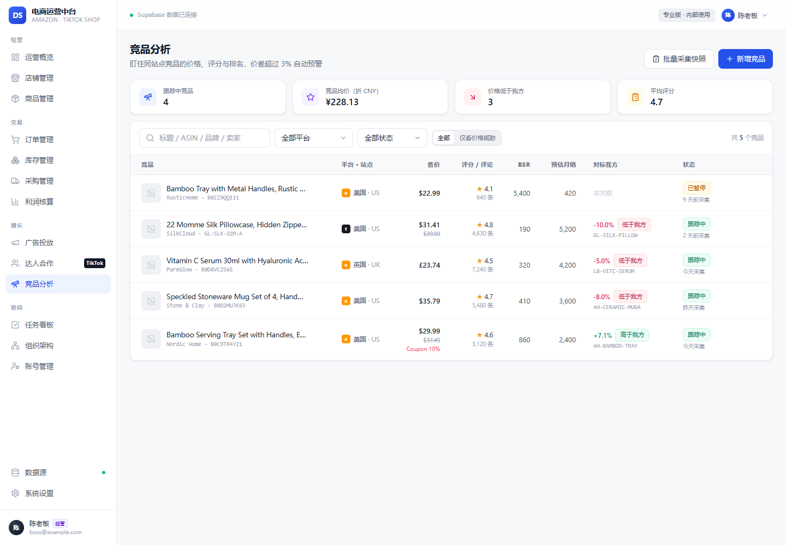
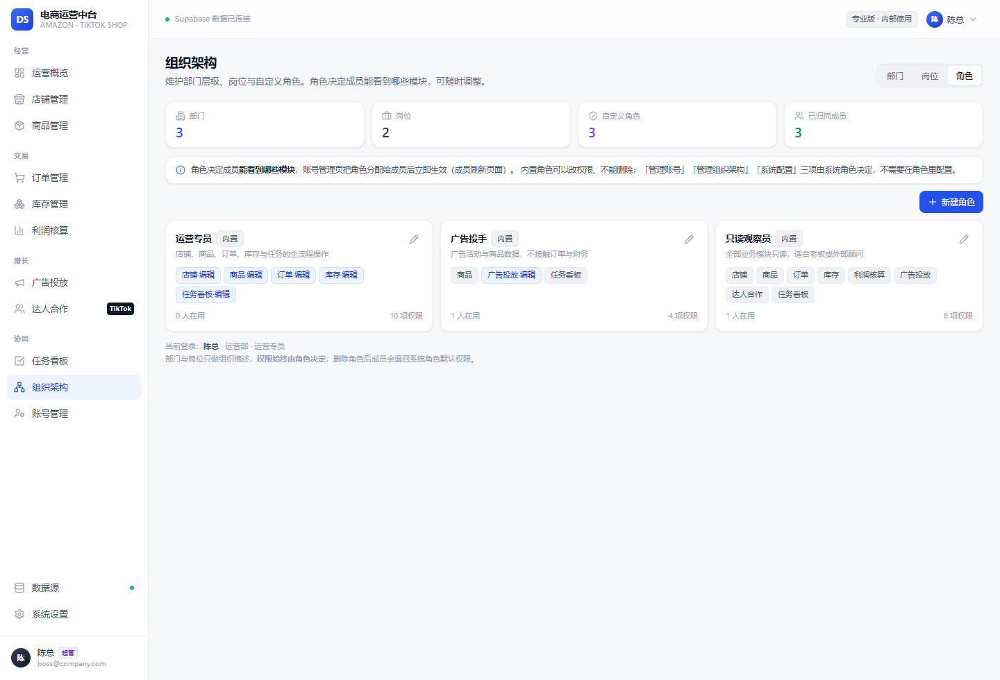
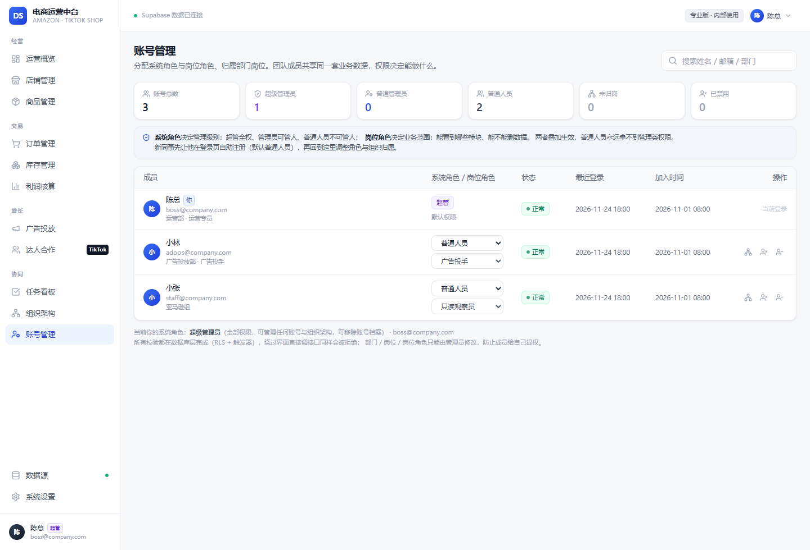
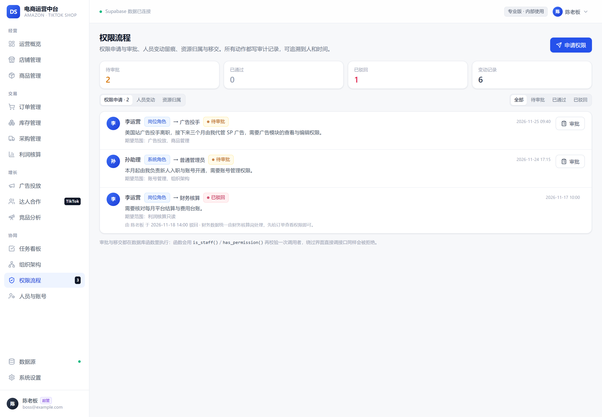

# 电商运营中台 · Dianshangxt

面向 **Amazon** 与 **TikTok Shop** 双平台的跨境电商运营管理系统。多店铺、多站点数据放在同一张运营报表里：订单、库存、采购、广告、达人、竞品、利润一次看清。

> 技术栈：React 18 + TypeScript + Vite + TailwindCSS + Recharts + Supabase (PostgreSQL)

**🌐 线上地址：<https://caifu-001.github.io/Dianshangxt/>**

前端由 GitHub Pages 托管（push `main` 自动构建发布），数据存放在 Supabase 云端。
首次使用前，需要在该 Supabase 项目的 SQL Editor 执行一次 `supabase/schema.sql` 建表。


> 驾驶舱：深色大屏，1920×1080 一屏铺满，30 秒自动轮询，新订单实时高亮

<details>
<summary>更多界面预览</summary>











</details>


---

## 功能模块

| 模块 | 能力 |
| --- | --- |
| 数据驾驶舱 | 投屏用深色大屏：今日 GMV / 订单 / 净利 / 客单价 / TACOS / 断货 SKU 六项实时指标，30 天销售利润趋势、平台结构、店铺贡献、热销 SKU、库存健康度、竞品价格监控、广告与达人漏斗、采购在途、实时订单流、异常跑马灯；15s / 30s / 60s 自动轮询，可一键全屏 |
| 运营概览 | GMV / 订单 / 净利润 / ACOS 指标卡，销售与利润趋势、平台占比、热销 Top5、库存预警、店铺表现、待办提醒 |
| 店铺管理 | Amazon / TikTok Shop 多店铺多站点档案，近 30 天销售额、订单、净利率、SKU 数、广告占比、目标 ACOS |
| 商品管理 | SKU / ASIN 档案、成本售价、毛利率，搜索筛选、CSV 批量导入导出 |
| 订单管理 | 逐单录入与平台报表导入，佣金 / FBA / 物流 / 广告 / 退款逐项拆解，**利润由数据库生成列自动计算** |
| 库存管理 | 可用 / 在途 / 预留、安全库存、日均销量，自动测算可售天数、补货建议，一键生成补货任务 |
| 采购管理 | 供应商档案（账期 / 交期 / 评级 / 累计采购额）、采购单与明细、部分到货登记，**收货可直接加进对应仓库的可售库存**，采购分析与 SKU 单价变动 |
| 广告投放 | SP / SB / SD / GMV Max / Video 活动，ACOS、ROAS、CTR、CVR、CPC，超目标自动标红，一键暂停 |
| 达人合作 | TikTok 达人建联漏斗（待联系 → 已联系 → 寄样 → 合作中），佣金率、带货 GMV、视频产出、待跟进提醒 |
| 竞品分析 | 同站点竞品价格 / 评分 / 评论 / BSR / 预估月销，关联我方 SKU 自动算价差，低于我方 3% 自动预警，按日快照画价格与评论趋势，一键生成跟进任务 |
| 利润核算 | 从 GMV 到净利润的完整损益表，费用构成环图、关键比率，费用台账（头程 / 仓储 / 订阅 / 佣金 / 税费） |
| 任务看板 | 待处理 / 进行中 / 已完成三列看板，模块、优先级、负责人、截止日，逾期标红 |
| 人员与账号 | **管理员直接开通账号**（不用本人自助注册）、部门 / 岗位 / 岗位角色分配、入职确认、办理离职与资源交接、停用启用、移除档案 |
| 权限流程 | 权限申请与审批（通过即生效）、人员变动流水（入职 / 调岗 / 权限变更 / 离职自动留痕）、按成员统计资源归属并移交 |
| 组织架构 | 部门树（多层嵌套）、岗位与职级、自定义角色与权限矩阵，管理员可自建 |
| 系统设置 | 账号资料、数据源状态与各表行数、演示数据生成、一键导出 schema、清空业务数据 |

### 数据驾驶舱怎么用

入口在侧边栏 **经营 → 数据驾驶舱**，或运营概览页头右侧的「数据驾驶舱」按钮。
它渲染在独立路由 `/cockpit`，不套工作台侧边栏，点右上角 ⛶ 进入全屏即可投屏。

- **不新增数据库表**，只读现有业务数据，所以升级上来**不需要重跑建表脚本**
- **实时机制**：默认 30 秒轮询一次，可切 15s / 30s / 60s 或暂停；页面切到后台时冻结，
  切回前台立刻补拉一次，避免大屏长期挂着空耗配额。右上角显示倒计时与最后更新时间
- **今日指标以「近 7 日日均」为基准**：今天还没过完，和昨天完整的 24 小时比必然偏低，会误导判断
- **新订单会高亮**：轮询拿到新的订单记录时，实时订单流对应行闪一下
- **单表容错**：某个模块没有权限（RLS 拒绝）只会让对应面板空着，不会整块白屏
- **权限**：沿用 `orders.view`，连订单都看不到的岗位也看不到驾驶舱

## 快速开始

```bash
npm install
npm run dev      # http://127.0.0.1:5173
```

## 首次使用：初始化数据库（必做）

1. 打开 <https://supabase.com/dashboard/project/rjdoimnicmibxfwcjchn/sql/new>（SQL Editor → New query）
2. 复制 `supabase/schema.sql` 的全部内容，粘贴并 **Run**

> **已经建过表？** 组织架构、竞品 / 采购、人员生命周期与权限流程都是后加的，
> 需要**重新完整执行一次**这个脚本。脚本是幂等的：只补表、补列、重建策略与触发器，不会清空已有数据。

3. 回到应用登录 / 注册，系统会自动检测并进入工作台
4. （可选）在「数据源」或「系统设置」中点击 **生成演示数据**，立刻看到完整报表

脚本是幂等的，可以重复执行；包含建表、索引、行级权限（RLS）与注册自动建档触发器。

> 也可以在登录后的「数据源」页面直接点「复制脚本 / 打开 SQL 编辑器」，无需打开本地文件。

> **注册后登录不了？** Supabase 默认开启「邮箱验证」，注册后需点邮件里的确认链接。
> 内部工具若不想验证，可到 Supabase 控制台 → Authentication → Sign In / Providers → Email，
> 关闭 **Confirm email** 后重新注册即可（已有账号需要再确认一次邮箱）。

## 角色与权限

权限由两层叠加：**系统角色**决定「管理级别」，**岗位角色（自定义角色）**决定「业务范围」。

### 系统角色

| 能力 | 超级管理员 | 普通管理员 | 普通人员 |
| --- | :--: | :--: | :--: |
| 查看 / 新增 / 编辑业务数据 | ✅ | ✅ | 按岗位角色 |
| 删除业务数据（订单 / 商品 / 店铺等） | ✅ | 按岗位角色 | 按岗位角色（上限内） |
| 进入「人员与账号」、调整成员角色与状态 | ✅ | ✅ | ❌ |
| 直接开通新账号 | ✅ | ✅ | ❌ |
| 办理离职、资源交接、恢复在职 | ✅ | 仅普通人员 | ❌ |
| 审批权限申请 | ✅ | ✅（不能批自己的） | ❌ |
| 进入「组织架构」维护部门 / 岗位 / 角色 | ✅ | ✅ | 只读 |
| 调整管理员 / 超级管理员的角色 | ✅ | ❌ | ❌ |
| 移除账号档案 | ✅ | ❌ | ❌ |
| 修改汇率 / 清空数据 / 生成演示数据 | ✅ | ✅ | ❌ |
| 修改自己的资料与密码 | ✅ | ✅ | ✅ |

**初始化顺序**：数据库里**第一个注册的账号自动成为超级管理员**，之后由管理员在
「人员与账号」页直接开通同事的账号，不再需要本人自助注册。

### 自定义角色（岗位角色）

管理员在「组织架构 → 角色」里自己创建角色，勾选它能访问的模块：

- 内置 5 个角色：运营专员、广告投手、内容达人、财务核算、只读观察员（可改权限，不可删除）
- 每个模块有「查看 / 编辑」两个开关，勾「编辑」会自动带上「查看」
- 另有「删除业务数据」总开关，控制该角色能否执行不可恢复的删除
- 角色分配在「账号管理」页，用下拉直接选，成员刷新页面即生效

业务模块共 10 个：店铺、商品、订单、库存、采购、利润、广告、达人、竞品、任务。

### 权限码

| 权限码 | 说明 |
| --- | --- |
| `stores.view` / `stores.edit` | 店铺查看 / 编辑 |
| `products.view` / `products.edit` | 商品查看 / 编辑 |
| `orders.view` / `orders.edit` | 订单查看 / 编辑 |
| `inventory.view` / `inventory.edit` | 库存查看 / 编辑 |
| `purchase.view` / `purchase.edit` | 采购单与供应商查看 / 编辑 |
| `profit.view` / `profit.edit` | 利润与费用台账查看 / 编辑 |
| `ads.view` / `ads.edit` | 广告查看 / 编辑 |
| `creators.view` / `creators.edit` | 达人查看 / 编辑 |
| `competitors.view` / `competitors.edit` | 竞品查看 / 编辑 |
| `tasks.view` / `tasks.edit` | 任务查看 / 编辑 |
| `data.delete` | 删除业务数据 |
| `account.manage` | 管理账号（仅管理员及以上，不可通过角色授予） |
| `org.manage` | 管理组织架构（同上） |
| `system.manage` | 系统配置（同上） |

### 组织架构

「组织架构」页有三个标签：

- **部门**：支持多层嵌套（如「运营部 → 亚马逊组」），可设负责人与职能说明；删除部门不会删除成员，只把归属置空
- **岗位**：描述职责与职级（P3 / P5 / M2 等，可自定义），与权限无关，避免「岗位=权限」的耦合
- **角色**：权限矩阵，见上一节

成员在「人员与账号」页逐个挂上部门、岗位与岗位角色，也可以直接用行内下拉快速切换岗位角色。

## 人员生命周期与权限流程

### 开通账号（管理员代建）

以前的做法是「让同事自己注册 → 管理员再改角色」，现在管理员可以直接建号：

1. 「人员与账号」→ **新建账号**
2. 填姓名、登录邮箱、初始密码（点「随机」自动生成 12 位强密码）、部门、岗位、系统角色、岗位角色、入职日期
3. 勾 **首次登录必须修改初始密码**（默认勾选）→ 本人登录后顶部会出现改密提示，改完自动消失
4. 创建成功后弹窗会显示**邮箱 + 初始密码**，一键复制发给本人（密码只显示这一次）

技术上是用一个**不持久化会话的一次性 Supabase 客户端**调注册接口，
所以不会覆盖管理员自己的登录态；建号后再用管理员会话补上组织归属与人事状态。

> 为什么不把部门 / 角色写在注册参数里？因为注册接口是匿名调用的，
> 参数里的 `user_metadata` 任何人都能伪造 —— 那样等于开了一个自助提权的口子。
> 所以角色只认管理员会话里的那次 update。

如果项目开着 **Confirm email**，本人需要点一次邮件里的确认链接才能登录；
内部工具可以在 Supabase → Authentication → Providers → Email 关掉它。

### 入职与离职

| 场景 | 操作 | 结果 |
| --- | --- | --- |
| 人还没到岗 | 建号时勾「待入职」 | 档案建好但账号停用，到期点「确认入职」开通 |
| 正常离职 | 行内 **办理离职** | 一次事务里完成资源移交 + 权限回收 + 停用 + 留痕 |
| 休假 / 临时停用 | 行内 **停用账号** | 失去数据访问，人事状态仍是「在职」，不影响离职率统计 |
| 离职又回来了 | 行内 **恢复在职** | 重新开通账号，部门 / 岗位 / 角色需要重新分配 |

**办理离职**弹窗会先清点该成员名下的资源（店铺、商品、订单、库存、广告、达人、任务、
费用、竞品、竞品快照、供应商、采购单、采购明细），然后：

1. 选一个接手人 → 这些记录整体转到接手人名下；不选则保留原归属，作为团队公共数据
2. 清空部门 / 岗位 / 岗位角色，系统角色降为普通人员
3. 账号停用，写入离职时间与原因
4. 整个过程在 `offboard_member()` 里**一次事务完成**，不会出现「资源转走了但权限还在」

超级管理员不能直接办理离职（要先把超管权限交出去），管理员也不能给自己办离职。

### 权限申请与审批

普通成员需要更多模块时，不用找管理员改后台：

- 「权限流程 → 申请权限」：选岗位角色或系统角色，写清理由与期望范围
- 管理员在同一个页面点「审批」，通过即生效（`decide_access_request()` 直接改 `profiles.role_id` / `role`）
- 管理员**不能审批自己的申请**；超管权限不在可申请范围内；授予管理员只有超管能做到
- 申请人可以在审批前撤回

### 人员变动流水与资源归属

「权限流程」页另外两个标签：

- **人员变动**：`employee_events` 表，由 `log_profile_change` 触发器自动写入 ——
  建档、转正入职、调岗、权限变更、停用、离职都会留一条，含操作人与时间，前端无法伪造
- **资源归属**：按成员汇总各模块记录数，可把某人名下资源整体移交给另一个人
  （`transfer_member_resources()`，离职交接走的也是这条链路）

### 权限生效的三层

① 侧边栏菜单按权限码过滤（看不到的模块不出现）；
② 路由守卫（直接输 URL 会看到「没有该模块的访问权限」）；
③ 数据库 RLS + 触发器（`public.has_permission(code)`），绕过界面调接口同样被拒绝。

**上限收敛**：普通人员即使被分配了带 `data.delete` 的角色，也拿不到删除权限 ——
系统角色是权限上限，自定义角色只能在其内收窄。同理，管理类权限无法通过角色授予。

**防提权**：`guard_profile_changes` 触发器拦住 `role` / `status` / `department_id` /
`position_id` / `role_id` 以及人事字段（`employment_status` / `hire_date` / `left_at` / `handover_to`）
的非管理员写入，普通成员改前端代码给自己挂全权限角色、或把自己改回「在职」都会被 Postgres 拒绝。

**防锁死**：超级管理员不能降低自己、不能移除自己；`ensure_super_admin()` 会在没有超管时
把最早注册的账号提上来。

**删除的安全性**：`deleteRow()` 会回读被删除的行数，RLS 拒绝时明确提示「没有删除权限」，
不会出现界面显示成功但其实没删的情况。

> 当前是**单团队共享**模型。如果需要多公司 / 多团队数据隔离，需要引入 `org_id` 并改写 RLS 策略，
> 这是另一套设计，需要的话告诉我。

## 账号安全

代码里已经内置的防护：

| 机制 | 说明 |
| --- | --- |
| 图形验证码 | Canvas 绘制 4 位字符（排除 0/O/1/I/L），点击换一张，校验失败自动刷新，登录/注册/发码前都需通过 |
| 密码强度 | 至少 8 位，且包含「小写 / 大写 / 数字 / 符号」中的两类，注册与改密时实时提示 |
| 失败锁定 | 同一邮箱连续输错 5 次，锁定 15 分钟并显示倒计时 |
| 邮箱验证码登录 | 一次性 6 位码，60 秒重发冷却，10 分钟有效，无需记密码 |
| 改密验证 | 修改密码前必须重新输入当前密码，避免会话被盗后直接接管账号 |
| 数据隔离 | 19 张表全部启用 RLS，按 `has_permission(权限码)` 判定，越权读写被 Postgres 拒绝 |
| 代建账号 | 管理员建号后密码只显示一次；可强制首次登录改密；建号不会覆盖管理员当前会话 |
| 离职回收 | 离职在数据库函数里一次事务完成：资源移交 + 清空组织归属 + 降级 + 停用，中间态不会残留 |

### 邮箱验证码要真正可用，需在 Supabase 做三步

**1. 配置自有 SMTP（必须）**
`Authentication` → `Emails` → `SMTP Settings`。
Supabase 内置邮件服务**每小时仅 2 封，且只能发给项目成员**，验证码基本发不出去。
推荐 Resend（免费 100 封/天）、SendGrid 或企业邮箱 SMTP。

**2. 让邮件显示 6 位数字（可选）**
`Authentication` → `Emails` → `Magic Link`，把正文里的 `{{ .ConfirmationURL }}` 换成 `{{ .Token }}`。
不换也能用 —— 邮件里是一条登录链接，用户点它同样能完成登录。

**3. 加 Redirect URL 白名单**
`Authentication` → `URL Configuration` → `Redirect URLs`，加入：

```
https://caifu-001.github.io/Dianshangxt/
http://127.0.0.1:5173/
```

> **失败锁定的边界**：前端锁定基于 `localStorage`，清缓存即可绕过，它拦的是"同一浏览器随手试密码"这类最廉价的手段。
> 服务端真正的防线是 Supabase Auth 自带的 rate limit。生产环境建议同时在
> `Authentication` → `Providers` → `Email` 里开启「Confirm email」并要求强密码。

## 竞品分析

盯竞品不是看一眼价格，而是**看它怎么变**。

1. **录入**：新增竞品时先选「对标我方商品」，站点、币种、类目自动带出；不关联也能用，只是不算价差
2. **采集**：新增时自动写一条今日快照；之后每次点「记录今日快照」或「批量采集快照」，同一天重复记录会覆盖当天数据
3. **判读**：
   - 价差 = （竞品折人民币 − 我方折人民币）/ 我方，负数表示竞品更便宜
   - 低于我方 **3%** 记为「低于我方」并计入「价格低于我方」预警；±3% 内算同一价格带
   - 详情弹窗里是双轴趋势：左轴售价、右轴评论数，下面列出每次采集的涨跌
4. **落地**：一键「生成跟进任务」写进任务看板（比价、改价、调 Listing 都能挂上去）

> 同一站点同一 ASIN 只允许跟踪一次（`uq_competitors_asin` 部分唯一索引，ASIN 为空时不限制，
> 方便录入 TikTok 这类没有 ASIN 的商品）。

## 采购管理

一条链路：**供应商 → 采购单 → 到货 → 库存**。

- **供应商**：账期、交期、评级、联系方式；表格右侧自动汇总「累计采购额 / 单数 / 最近一次下单」
- **采购单**：明细里选商品会自动带出 SKU 与档案成本，数量和单价可覆盖；金额 = 明细合计 + 运费 + 其他费用（不落库，避免和明细对不上）
- **登记到货**：按明细填本次到货数量，可勾选「同步到库存可售数量」——
  按「店铺 + SKU + 仓库」累加到 `inventory.available_qty`，没有对应库存记录则自动新建
- **状态流转**：草稿 → 待到货 →（部分到货）→ 已入库，全部到齐时自动置为「已入库」
- **采购分析**：近 6 个月采购额、供应商采购额 Top、状态分布、同一 SKU 最近两次采购单价涨跌

两个边界要清楚：

- 收货同步只增加**可售库存**，不会修改商品档案的 `cost_price`（采购价含不含运费、要不要摊，是业务口径，留给人决定）
- 删除采购单**不会回滚**已经同步进库存的数量，需要的话到「库存管理」手动调整

> 实现上，采购明细与竞品快照属于子表：它们的增删改跟随主表的 `edit` 权限，
> 不额外要求 `data.delete`。否则「能编辑但无删除权」的岗位一改单子就会被 RLS 拒绝。

## 多币种与汇率

Amazon 各站点币种不同（USD / GBP / EUR / JPY…），系统统一以 **USD 为基准**折算后再汇总：

- 「系统设置 → 汇率与币种」可维护 `1 USD = ?` 的各币种汇率，保存到 `profiles.settings.fx`
- 运营概览、订单合计、广告 KPI、利润表均按该汇率折算
- 单店铺视图仍以该店铺本币展示明细，费用台账保留录入币种


## 环境变量

`.env.example` 中的配置已内置默认值，可覆盖：

```env
VITE_SUPABASE_URL=https://rjdoimnicmibxfwcjchn.supabase.co
VITE_SUPABASE_KEY=sb_publishable_vBOpo9IQaKPg4ACt_nLopg_oiJQAKhy
```

`publishable` / `anon` key 按设计是公开的，安全性由 RLS 保证：**数据范围由权限码决定，越权请求会被 Postgres 拒绝**。
切勿把 `service_role` 密钥放进前端。

## 数据模型

```
stores ──┬── products ── inventory
         ├── orders
         └── campaigns

creators (TikTok 达人)     tasks (运营任务)     expenses (费用台账)

competitors ── competitor_snapshots (按日价格 / 评分快照)
suppliers ── purchase_orders ── purchase_items (采购明细，含已到数量)

organization:
departments ──┬── positions
              └── profiles.department_id
roles ──────────── profiles.role_id（岗位角色）
profiles (账号档案，与 auth.users 一对一；含 role / status / 部门 / 岗位 / 角色
          + 人事字段：employment_status / hire_date / left_at / left_reason / handover_to)
access_requests (权限申请，申请人与审批人都在这里)
employee_events (人员变动流水，触发器自动写入，前端只读)
```

- 所有业务表带 `user_id`（默认 `auth.uid()`，仅作创建者审计）
- 读写范围由 RLS 按权限码判定（`has_permission`），团队成员共享同一套数据
- `orders.gross_amount` / `orders.profit` / `purchase_items.amount` 为 PostgreSQL 生成列，客户端无需维护
- `orders` 对 `(store_id, order_no)` 唯一，`products` 对 `(store_id, sku)` 唯一，采购单对 `po_no` 唯一，重复导入会被拒绝
- 离职交接（`offboard_member`）、资源移交（`transfer_member_resources`）、权限审批（`decide_access_request`）
  三个流程都放在数据库函数里，函数内部重新校验调用者身份，并自然留痕

## 导入模板

**订单报表**：订单号、日期、店铺、SKU、商品、数量、单价、佣金、履约费、物流、广告分摊、退款、国家、买家
（Amazon「订单报告」与 TikTok「订单导出」CSV 的常见列名已内置别名映射，可直接上传）

**商品**：店铺、SKU、ASIN、商品名称、类目、成本、售价

列名支持中英文与常见平台字段名，导入前可在弹窗中手动调整对应关系。

## 脚本

```bash
npm run dev        # 本地开发
npm run typecheck  # 类型检查
npm run build      # 生产构建（输出 dist/）
npm run preview    # 预览构建产物
```

## 部署

当前线上版本跑在 **GitHub Pages**：<https://caifu-001.github.io/Dianshangxt/>

- 推送 `main` 触发 `.github/workflows/deploy.yml`：`npm install` → 类型检查 → 构建 → 发布
- 构建产物的资源前缀由 `vite.config.ts` 的 `base` 控制，生产模式固定为 `/Dianshangxt/`
- 构建后自动把 `index.html` 复制成 `404.html`，用于兜住 SPA 子路由刷新（Pages 无服务端 rewrite）
- 仓库改名或绑定自定义域名时，在 `.env` 里设置 `VITE_BASE_PATH=/` 即可（此时 basename 也会自动变）

也可以部署到 Vercel / Netlify / Cloudflare Pages 等任意静态托管，
此时把 `VITE_BASE_PATH` 设为 `/`，并配置 history fallback（所有路径回退到 `index.html`）。

## 目录结构

```
├─ supabase/
│  └─ schema.sql            # 数据库初始化脚本（建表 + RLS + 触发器）
├─ src/
│  ├─ components/           # UI 组件、布局、图表、导入弹窗
│  ├─ context/              # 认证上下文
│  ├─ hooks/                # useAsync 等
│  ├─ lib/                  # supabase 客户端、数据访问、类型、常量、演示数据
│  └─ pages/                # 13 个业务页面
└─ index.html
```
