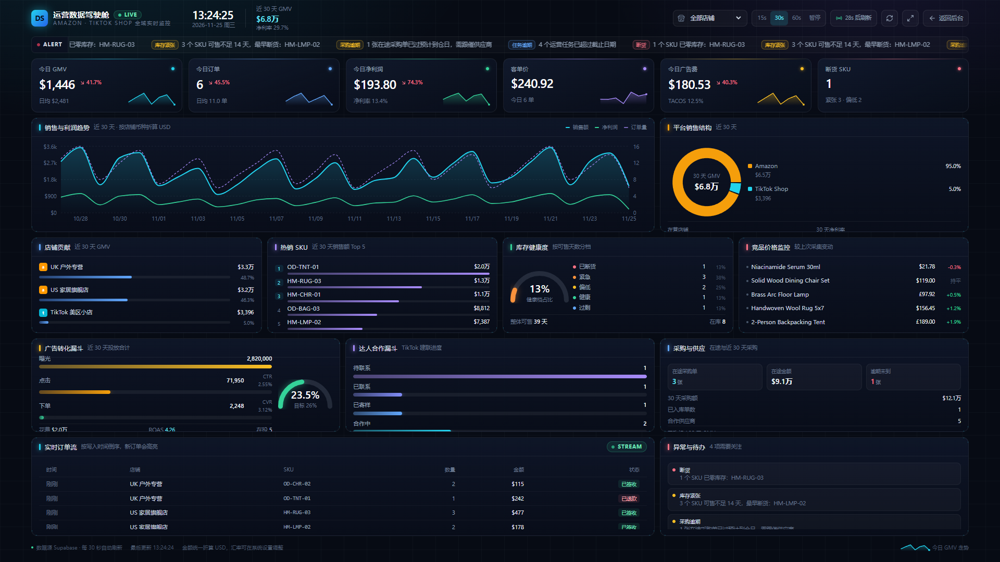
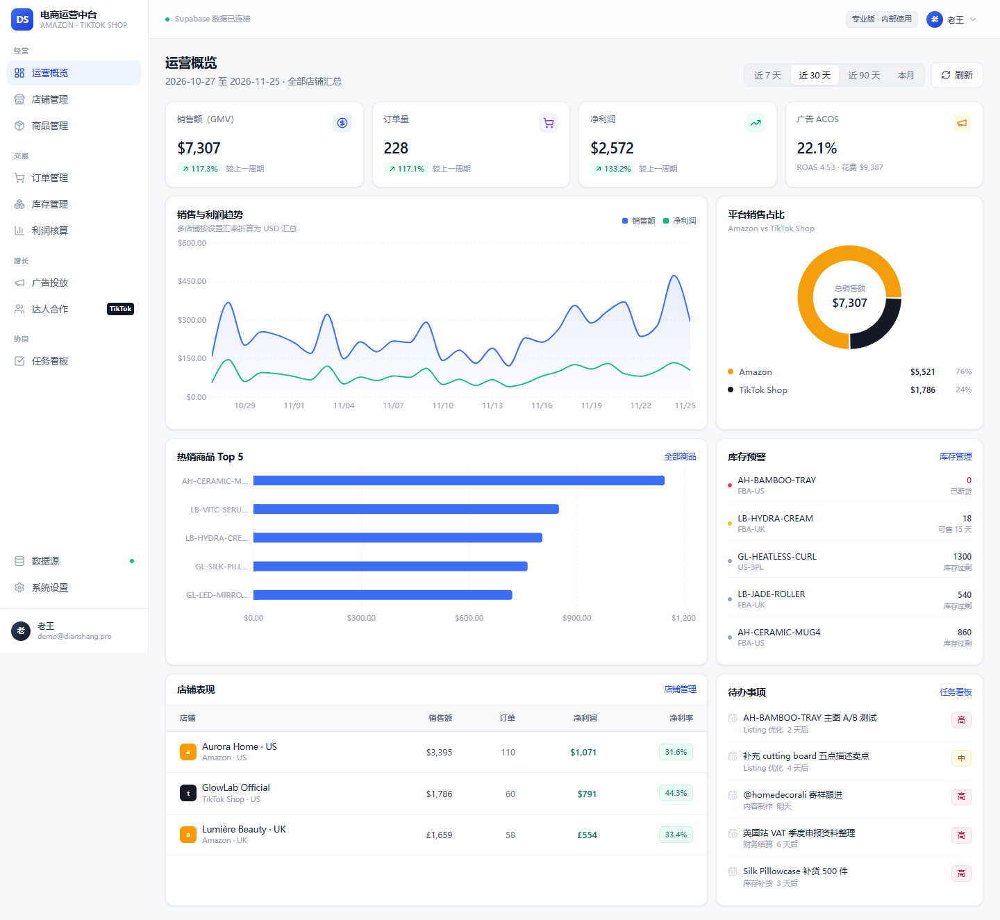
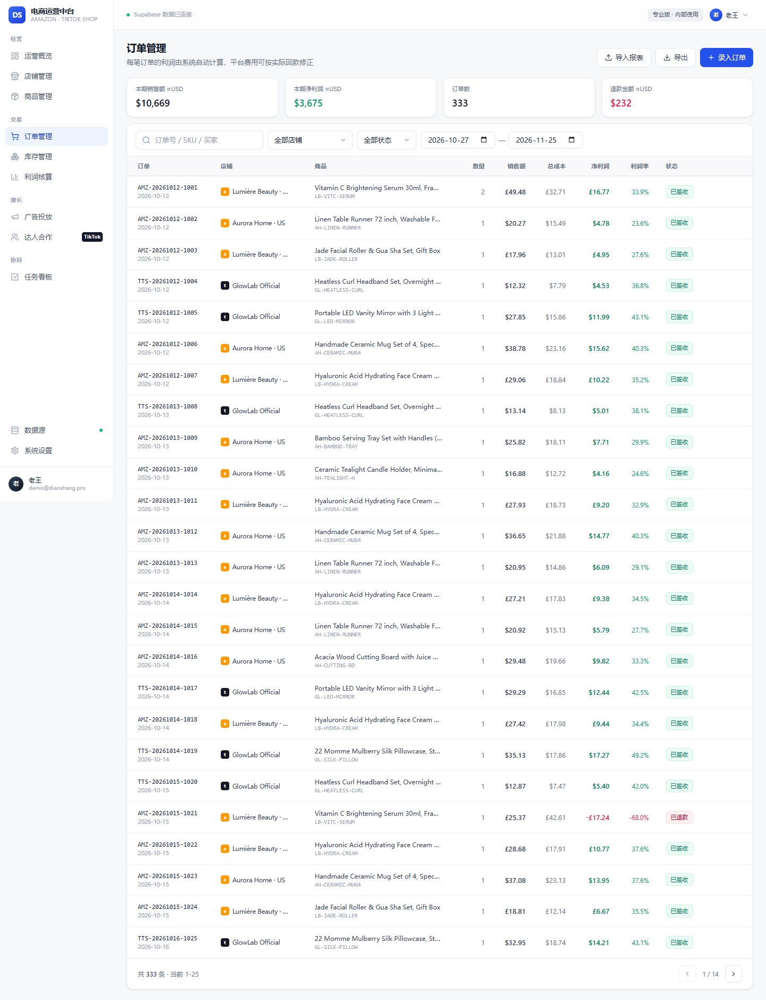
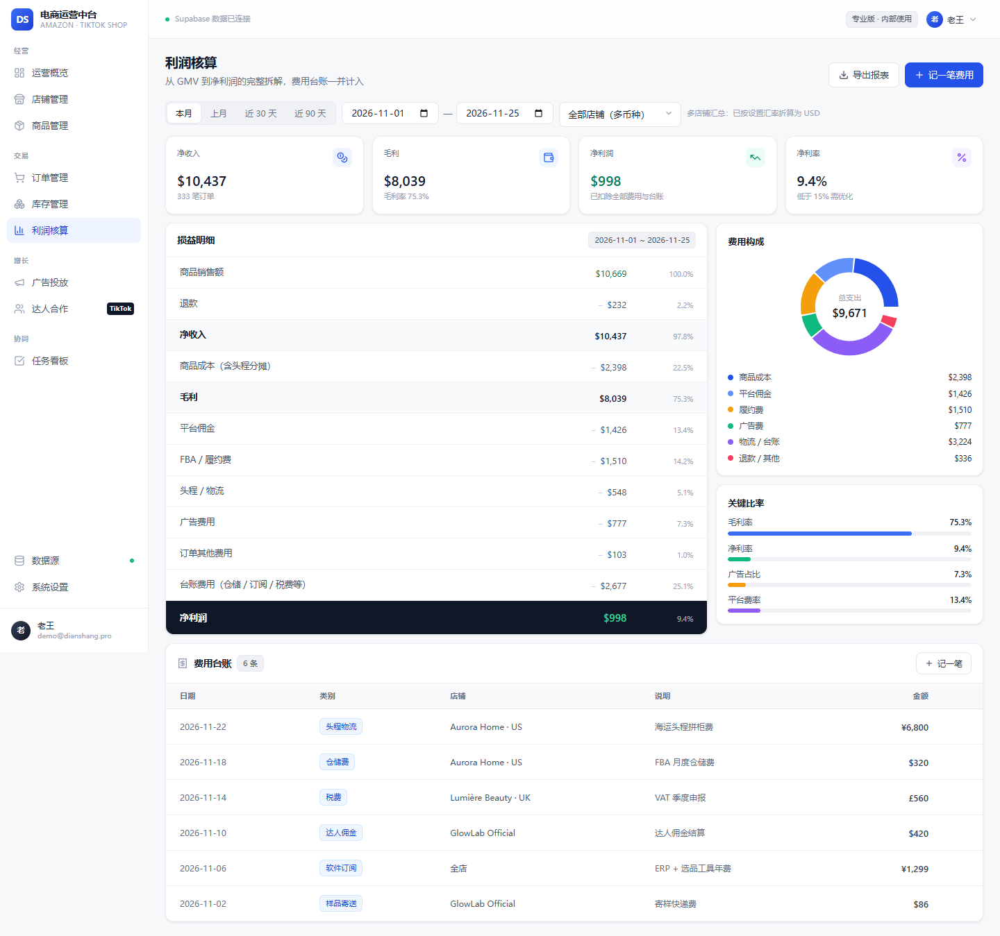
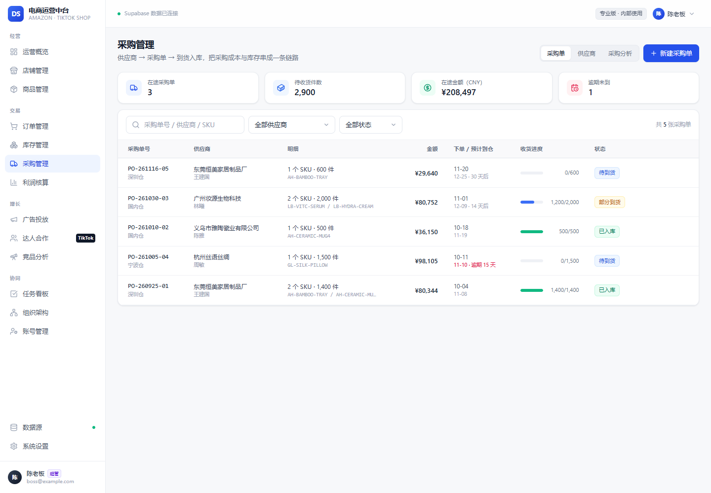

# 电商运营中台 · Dianshangxt

面向 **全球主流跨境平台** 的跨境电商运营管理系统。内置 18 个平台（Amazon、TikTok Shop、Shopee、Lazada、Temu、Walmart、eBay、AliExpress、Mercado Libre、Shopify、Etsy、SHEIN、Target、Wayfair、Noon、Coupang、Ozon、Newegg），**每家公司可自行勾选自己经营的平台**。多店铺、多站点数据放在同一张运营报表里：订单、库存、采购、广告、达人、竞品、利润一次看清。

> 技术栈：React 18 + TypeScript + Vite + TailwindCSS + Recharts + Supabase (PostgreSQL)

**🌐 线上地址：<https://kuahaishidai.dpdns.org/>**

（旧地址 <https://caifu-001.github.io/Dianshangxt/> 仍可访问）

前端由 GitHub Pages 托管（push `main` 自动构建发布），数据存放在 Supabase 云端。
首次使用前，需要在该 Supabase 项目的 SQL Editor 执行一次 `supabase/schema.sql` 建表。



> 驾驶舱：深色大屏，1920×1080 一屏铺满，30 秒自动轮询，新订单实时高亮

<details>
<summary>更多界面预览</summary>











</details>


---

## 功能模块

| 模块 | 能力 |
| --- | --- |
| 数据驾驶舱 | 投屏用深色大屏：今日 GMV / 订单 / 净利 / 客单价 / TACOS / 断货 SKU 六项实时指标，30 天销售利润趋势、平台结构、店铺贡献、热销 SKU、库存健康度、竞品价格监控、广告与达人漏斗、采购在途、实时订单流、异常跑马灯；15s / 30s / 60s 自动轮询，可一键全屏 |
| 运营概览 | GMV / 订单 / 净利润 / ACOS 指标卡，销售与利润趋势、平台占比、热销 Top5、库存预警、店铺表现、待办提醒 |
| 店铺管理 | **18 个海外平台**多店铺多站点档案，新增店铺时平台下拉按本公司「经营平台」配置过滤，并自动带入常用站点与币种；近 30 天销售额、订单、净利率、SKU 数、广告占比、目标 ACOS |
| 商品管理 | SKU / ASIN 档案、成本售价、毛利率，搜索筛选、CSV 批量导入导出 |
| 订单管理 | 逐单录入与平台报表导入，佣金 / FBA / 物流 / 广告 / 退款逐项拆解；指定责任人；**履约中心**一屏看海外仓 / 公司国内仓库存与在途，可直接出库、创建国内仓→海外仓调拨、缺货一键转采购，**单据全链路可追溯** |
| 库存管理 | 可用 / 在途 / 预留、安全库存、日均销量，自动测算可售天数；**出入库流水**记录每笔变动来源，**在途调拨**视图确认头程到货，补货建议可批量转采购单 |
| 采购管理 | 采购单与明细、**财务审核闸门**（提交 → 通过/驳回，未通过不能付款）、审核流水留痕、**采购付款登记**（多次付款自动算已付/未付）、部分到货入库、加权成本回流商品档案、采购分析与 SKU 单价变动 |
| 产品开发 | 自有品牌新品全流程：项目档案（编号 / 类目 / 品牌 / 负责人 / 目标成本售价 / 打样供应商）、阶段看板（调研 → 立项 → 打样 → 测试 → 量产 → 上市）、阶段节点清单、开发费用台账、上市后关联 SKU 销售与毛利表现 |
| 站内品牌营销 | 原「广告投放」与「达人合作」合并为一个模块，两个标签切换：**广告投放**（SP / SB / SD / GMV Max / Video 活动，ACOS、ROAS、CTR、CVR、CPC，超目标自动标红，一键暂停）+ **达人合作**（TikTok 达人建联漏斗、佣金率、带货 GMV、视频产出、待跟进提醒），费用可一键归集到费用管理 |
| 竞品分析 | 同站点竞品价格 / 评分 / 评论 / BSR / 预估月销，关联我方 SKU 自动算价差，低于我方 3% 自动预警，按日快照画价格与评论趋势，一键生成跟进任务 |
| 站外品牌营销 | 社媒账号（粉丝 / 内容数）、站外红人（报价 / 合作状态 / 联系人）、公共关系（媒体 / 发稿记录）与曝光 / 搜索量按日录入，自动汇总本月曝光、品牌词搜索与趋势曲线 |
| 利润核算 | 从 GMV 到净利润的完整损益表，费用构成环图、关键比率、费用台账；**利润可按责任人 / 部门归属** |
| 费用管理 | **研发 / 营销 / 工资社保 / 差旅 / 办公等费用单 + 多条明细**：费用单、月度预算与执行率、财务审核闸门（提交 → 通过/驳回 → 登记付款）、审批流水、类别占比与月度趋势分析、CSV 导出；**广告投放 / 达人合作 / 站外品牌营销 / 产品开发费用一键归集并对照** |
| 任务看板 | 三列看板，模块、优先级、负责人、截止日，逾期标红；**可挂到真实账号**，完成情况计入绩效执行分 |
| 人员与账号 | **管理员直接开通账号**（不用本人自助注册）、员工工号 / 职位 / 部门 / 电话 / 微信 / 邮箱档案、岗位角色分配、入职确认、办理离职与资源交接、停用启用、移除档案；支持按工号 / 姓名 / 联系方式搜索。人力资源部（`hr.view` / `hr.manage`）也能办理入离职与调岗；**员工工号只有管理员 / 人力岗可编辑，其他成员（含本人）只读，数据库守卫同步拦截**；新建账号自动推荐工号（E1001 起按公司顺延），**离职工号封存保留、不重复分配** |
| 权限流程 | 权限申请与审批（通过即生效）、人员变动流水（入职 / 调岗 / 权限变更 / 离职自动留痕）、按成员统计资源归属并移交 |
| 组织架构 | 部门树（多层嵌套）、**部门可见范围矩阵**（哪个部门能看哪些模块，可继承上级）、岗位与职级、自定义角色、成员归属与有效权限总览 |
| 公司管理 | **仅平台超级管理员可见**（侧边栏「平台」分组）：创建 / 编辑 / 停用公司、查看各公司成员数、切换当前数据视角；公司之间业务数据完全隔离 |
| 系统日志 | **仅平台超级管理员可见**：全平台所有公司的只读审计轨迹，覆盖登录 / 退出、角色 / 状态 / 公司归属变更、公司创建与更新、成员调配、入驻审核，以及普通账号的业务操作、前端运行异常、接口失败与越权拦截（供故障排查）。每条日志带来源公司；支持按公司、类别、级别、关键词筛选。审计类事件由数据库函数与触发器写入、前端只能上报自己的业务 / 错误事件，操作人身份取登录态无法伪造，日志不可篡改。**空间占用过大时超管可在页内清理**：按保留天数（30/90/180/365 天）删除历史日志，或输入 `CLEAR` 二次确认清空全部；清理动作本身会留痕，清空后仍保留 1 条清理记录 |
| 绩效管理 | 按周期录入分数 / 等级 / 四项分项 / 评语；**可一键按订单 / 采购 / 任务真实数据算分**，自动汇总部门平均分与待评名单；成员只能看到自己的结果 |
| 供应商库 | **独立供应商管理库**：编码 / 多位联系人（主联系人）/ 电话 / 邮箱 / 官网 / 地址 / 税号 / 开户行 / 资质 / 标签 / 业务负责人，多款可供产品与报价，供货绩效（采购额 / 付款 / 到货 / 准时率）自动汇总，CSV 导入导出 |
| 系统设置 | 账号资料、**经营平台（公司管理员可勾选本公司经营的平台）**、数据源状态与各表行数、演示数据生成、一键导出 schema、清空业务数据；**平台超管额外可用「清理演示数据」**：按演示店铺 Seller ID / SKU 前缀（AH-/LB-/GL-）/ 固定供应商与档案编号精确识别，只删演示数据、不碰真实录入数据，清理前展示逐表条数统计，输入 `PURGE DEMO` 二次确认，按当前管理视角公司清理，操作写入系统日志 |

### 数据驾驶舱怎么用

入口在侧边栏 **经营 → 数据驾驶舱**，或运营概览页头右侧的「数据驾驶舱」按钮。
它渲染在独立路由 `/cockpit`，不套工作台侧边栏，点右上角 ⛶ 进入全屏即可投屏。

- **不新增数据库表**，只读现有业务数据，所以升级上来**不需要重跑建表脚本**
- **实时机制**：默认 30 秒轮询一次，可切 15s / 30s / 60s 或暂停；页面切到后台时冻结，
  切回前台立刻补拉一次，避免大屏长期挂着空耗配额。右上角显示倒计时与最后更新时间
- **今日指标以「近 7 日日均」为基准**：今天还没过完，和昨天完整的 24 小时比必然偏低，会误导判断
- **新订单会高亮**：轮询拿到新的订单记录时，实时订单流对应行闪一下
- **单表容错**：某个模块没有权限（RLS 拒绝）只会让对应面板空着，不会整块白屏
- **权限**：沿用 `orders.view`，连订单都看不到的岗位也看不到驾驶舱

## 快速开始

```bash
npm install
npm run dev      # http://127.0.0.1:5173
```

## 首次使用：初始化数据库（必做）

1. 打开 <https://supabase.com/dashboard/project/rjdoimnicmibxfwcjchn/sql/new>（SQL Editor → New query）
2. 复制 `supabase/schema.sql` 的全部内容，粘贴并 **Run**

> **已经建过表？** 组织架构、竞品 / 采购、人员生命周期、权限流程、部门可见范围、绩效、业务链路（付款 / 库存流水 / 责任人与绩效算分）、供应商库、多联系人、站外品牌营销、采购财务审核、产品开发与履约调拨都是后加的，
> 需要**重新完整执行一次**这个脚本。脚本是幂等的：只补表、补列、重建策略与触发器，不会清空已有数据。

3. 回到应用登录 / 注册，系统会自动检测并进入工作台
4. （可选）在「数据源」或「系统设置」中点击 **生成演示数据**，立刻看到完整报表

脚本是幂等的，可以重复执行；包含建表、索引、行级权限（RLS）与注册自动建档触发器。

> 也可以在登录后的「数据源」页面直接点「复制脚本 / 打开 SQL 编辑器」，无需打开本地文件。

> **注册后登录不了？** Supabase 默认开启「邮箱验证」，注册后需点邮件里的确认链接。
> 内部工具若不想验证，可到 Supabase 控制台 → Authentication → Sign In / Providers → Email，
> 关闭 **Confirm email** 后重新注册即可（已有账号需要再确认一次邮箱）。

## 多租户：公司与数据隔离

系统按公司（租户）隔离，可在一套部署里服务多家公司。

- **平台超级管理员固定为 `yinsuccess168@163.com`**，不属于任何公司；侧边栏「平台 → 公司管理」只有他能看见。他通过「切换视角」决定当前查看哪家公司的数据，视图内的订单 / 库存 / 采购 / 费用 / 人员都只来自该公司。
- **公司内部最高角色是普通管理员（`admin`）**：只能管本公司成员与业务，无法创建超级管理员，也看不到平台超管。建号时新同事从「默认公司」划入当前公司，跨公司挪人只能由平台超管操作。
- **成员归属调配（平台超管专属）**：「公司管理 → 成员调配」可列出全部成员及当前所属公司，勾选多人后批量移动到任一启用公司（不限于默认公司），支持按姓名 / 邮箱 / 工号 / 公司搜索。移动只改账号归属，不动业务数据的原公司隔离；已在目标公司的成员会被禁用勾选。普通管理员仍只能在建号时把新同事从默认公司拉进本公司。
- **普通账号看不到超管**：通讯录、人员列表、人员变动流水都按 `company_id` 过滤，平台超管不属于任何公司，因此不会出现在普通公司的列表或审计日志里；平台超管本人仍能看到自己。
- **当前公司信息可见**：登录后页面右上角显示所属公司名称（平台超管显示当前切换的管理视角公司），「系统设置 → 所属公司」只读卡片可查看公司名称 / 编码 / 状态 / 成员数 / 创建时间。数据来自 `my_company()` 函数，只放行当前公司这一行，不会暴露别家公司。
- **底层技术状态仅超管可见**：顶栏的 Supabase 连接状态灯、侧边栏「数据源」入口、系统设置的「数据源」卡片、驾驶舱页脚的 Supabase 字样，只有平台超级管理员能看到；普通账号与公司管理员不会看到数据库初始化 / 连接状态等技术信息。
- **导航顺序自定义（个人偏好）**：点侧边栏顶部 Logo 旁的抓手图标进入排序模式，用每个分组标题右侧、每个菜单项右侧的上下箭头调整「板块顺序」和「板块内子项顺序」，✓ 保存、⟲ 恢复默认、✕ 取消。顺序存在本人档案 `profiles.settings.navOrder`（仅改自己的偏好，RLS 只放行本人更新），只影响当前账号、不影响他人；无权限看到的模块仍按权限隐藏，新增模块会自动补到末尾。
- **隔离落在数据库层**：所有业务表与 `profiles` 都带 `company_id`，RLS 策略统一要求 `in_company(company_id)`；写入时由触发器自动补公司归属，前端页面无需改动。`security definer` 函数（订单 / 采购 / 费用 / 绩效等）额外加了目标行公司校验，绕过界面也拿不到别家公司的数据。
- **部门 / 岗位 / 角色是平台级模板，全公司共享**：各公司的「运营部」「财务部」可见模块定义保持一致，由平台统一维护；业务数据与人员档案则完全隔离。

### 公司经营平台（每家公司自己选）

系统内置 **18 个主流海外平台**：Amazon、TikTok Shop、Shopee、Lazada、Temu、Walmart、eBay、AliExpress、Mercado Libre、Shopify、Etsy、SHEIN、Target、Wayfair、Noon、Coupang、Ozon、Newegg。

- **在哪选**：「系统设置 → 经营平台」。公司管理员与平台超管可勾选，普通成员只读。配置按公司隔离，A 公司选的平台不会影响 B 公司。
- **生效范围**：新增店铺、竞品、广告的平台下拉只列出本公司已启用的平台；新增店铺自动带入该平台常用站点与默认币种；新建订单按平台默认佣金率预估；广告类型按平台实际支持的类型展示（独立站等无站内广告的平台会给出提示，站外投放走费用管理）。
- **未配置时怎么办**：一个平台都不勾选时各模块展示全部 18 个平台，保证老公司升级后不会被卡住。
- **全站统一**：平台图标 / 简称 / 配色 / 常用站点 / 广告类型 / 默认佣金率集中在 `src/lib/constants.ts` 的 `PLATFORM_CATALOG`，运营概览与数据驾驶舱的平台占比图按全部平台动态分组，不再写死 Amazon / TikTok 两类。
- **存储与权限**：勾选结果存在 `companies.settings.enabled_platforms`，通过 `company_platforms()` / `set_company_platforms()` 两个 `security definer` RPC 读写（`companies` 表 RLS 仅放行超管，公司管理员走 RPC），保存动作写入系统日志。
- **新增平台**：在 `PLATFORM_CATALOG`、`PLATFORM_HEX`、`types.ts` 的 `Platform` 联合类型、`schema.sql` 中四处平台 CHECK 约束同步添加编码，重跑幂等脚本即可。

- **公司自助入驻 + 超管审核**：登录页「注册公司」由负责人填写公司名称 / 编码与管理员账号，账号先落 `pending`（不可访问业务数据）并生成入驻申请；平台超管在「公司管理 → 公司入驻审核」通过或驳回。通过后自动创建公司、负责人成为该公司普通管理员并激活；驳回可填原因。负责人自助提交的公司名只作为申请信息，角色一律由后端决定，无法伪造提权。

> **升级注意**：执行新版 `schema.sql` 后，旧数据全部归入「默认公司」；原先用其它邮箱做超级管理员的账号会被降级为普通管理员，请确保 `yinsuccess168@163.com` 已注册。公司信息展示依赖新增的 `my_company()` 函数，重跑脚本前右上角与设置页不会显示。
> 若只希望管理员代建账号，可在 Supabase 关闭公开注册；需要负责人自助入驻时请保持 Email 注册开启（邮箱确认也可，审核在确认后进行）。

## 角色与权限

权限由**三层**叠加：**系统角色**决定「管理级别」，**部门**决定「团队能看哪些模块」，**岗位角色（自定义角色）**给个人额外的业务范围。三者取并集后仍受系统角色上限约束（普通人员永远拿不到账号管理、组织管理、系统配置与删除）。

### 系统角色

| 能力 | 超级管理员 | 普通管理员 | 普通人员 |
| --- | :--: | :--: | :--: |
| 查看 / 新增 / 编辑业务数据 | ✅ | ✅ | 按部门范围 + 岗位角色 |
| 删除业务数据（订单 / 商品 / 店铺等） | ✅ | 按岗位角色 | 按岗位角色（上限内） |
| 进入「人员与账号」、调整成员角色与状态 | ✅ | ✅ | 人事岗（`hr.manage`）可办理入离职、调岗、启停普通人员账号，但不能改角色 |
| 直接开通新账号 | ✅ | ✅ | ❌ |
| 办理离职、资源交接、恢复在职 | ✅ | 仅普通人员 | 人事岗仅普通人员 |
| 审批权限申请 | ✅ | ✅（不能批自己的） | ❌ |
| 进入「组织架构」维护部门 / 岗位 / 角色 | ✅ | ✅ | 只读 |
| 创建 / 管理 / 切换公司（平台级） | ✅ | ❌ | ❌ |
| 调整管理员 / 超级管理员的角色 | ✅（超管账号唯一，不可改） | ❌ | ❌ |
| 移除账号档案 | ✅ | ❌ | ❌ |
| 修改汇率 / 清空数据 / 生成演示数据 | ✅ | ✅ | ❌ |
| 清理演示数据（按特征精确识别、仅超管） | ✅ | ❌ | ❌ |
| 修改自己的资料与密码 | ✅ | ✅ | ✅ |

**初始化顺序**：平台超管固定为 `yinsuccess168@163.com`（不论第几个注册），其余新注册账号均为普通人员并进入默认公司。
之后由各公司管理员在「人员与账号」页直接开通同事账号，不再需要本人自助注册；公司内最高只能授予普通管理员。

### 自定义角色（岗位角色）

管理员在「组织架构 → 角色」里自己创建角色，勾选它能访问的模块：

- 内置 6 个角色：运营专员、广告投手、内容达人、财务核算、只读观察员、人力资源专员（可改权限，不可删除）
- 每个模块有「查看 / 编辑」两个开关，勾「编辑」会自动带上「查看」
- 另有「删除业务数据」总开关，控制该角色能否执行不可恢复的删除
- 角色分配在「账号管理」页，用下拉直接选，成员刷新页面即生效

业务模块共 11 个：店铺、商品、订单、库存、采购、利润、广告、达人、竞品、任务、绩效。

### 权限码

| 权限码 | 说明 |
| --- | --- |
| `stores.view` / `stores.edit` | 店铺查看 / 编辑 |
| `products.view` / `products.edit` | 商品查看 / 编辑 |
| `orders.view` / `orders.edit` | 订单查看 / 编辑 |
| `inventory.view` / `inventory.edit` | 库存查看 / 编辑 |
| `purchase.view` / `purchase.edit` | 采购单与供应商查看 / 编辑 |
| `dev.view` / `dev.edit` | 产品开发（项目 / 节点 / 费用）查看 / 编辑 |
| `profit.view` / `profit.edit` | 利润与费用台账查看 / 编辑 |
| `ads.view` / `ads.edit` | 站内品牌营销 · 广告投放标签查看 / 编辑（权限码保留，兼容已有角色授权） |
| `creators.view` / `creators.edit` | 站内品牌营销 · 达人合作标签查看 / 编辑（权限码保留，兼容已有角色授权） |
| `competitors.view` / `competitors.edit` | 竞品查看 / 编辑 |
| `brand.view` / `brand.edit` | 站外品牌营销（社媒 / 红人 / 公关 / 曝光搜索）查看 / 编辑 |
| `tasks.view` / `tasks.edit` | 任务查看 / 编辑 |
| `performance.view` / `performance.edit` | 绩效查看 / 录入评定 |
| `hr.view` | 查看人事档案与花名册（部门职能，可授予普通人员） |
| `hr.manage` | 办理入职 / 离职 / 调岗（部门职能，只能动普通人员，不能改角色） |
| `finance.audit` | **采购财务审核**（部门职能）：通过后采购单才能登记付款；不能审核自己创建的单 |
| `data.delete` | 删除业务数据 |
| `account.manage` | 管理账号（仅管理员及以上，不可通过角色授予） |
| `org.manage` | 管理组织架构（同上） |
| `system.manage` | 系统配置（同上） |

### 组织架构与部门可见范围

「组织架构」页有四个标签：

- **部门**：支持多层嵌套（如「运营部 → 亚马逊组」），可设部门编码、负责人、职能说明与**可见范围**；删除部门不会删除成员，只把归属置空
- **岗位**：描述职责与职级（P3 / P5 / M2 等，可自定义），与权限无关，避免「岗位=权限」的耦合
- **角色**：岗位角色权限矩阵，见上一节
- **权限总览**：部门 × 模块的可见范围矩阵 + 成员归属与有效权限表，一眼看清「谁在哪个部门、为什么能看到这个模块」

部门范围是**团队级授权**：部门内所有成员自动获得，不用给每个人单独配角色。
子部门默认继承上级，也可以单独关闭（适合保密团队）。矩阵里点格子即可三态切换：无 → 只读 → 可编辑。

默认模板（可在部门弹窗里一键套用）：

| 部门 | 编码 | 默认可见范围 |
| --- | --- | --- |
| 信息中心 | IT | 全部 11 个业务模块可读写 + 人事档案只读（负责系统与数据支持；账号管理仍由管理员系统角色决定） |
| 人力资源部 | HR | 绩效（读写）+ 人事档案 + 入离职办理 + 任务看板 |
| 运营部 | OPS | 店铺、商品、订单、库存、采购、任务（读写）+ 绩效只读 |
| 广告投放部 | ADS | 广告、竞品（读写）+ 商品 / 任务只读 + 绩效只读 |
| 内容营销部 | CONTENT | 达人（读写）+ 商品只读 + 任务（读写）+ 绩效只读 |
| 财务部 | FIN | 利润与费用（读写）+ 订单 / 采购 / 商品 / 店铺只读 + 绩效只读 |

成员在「人员与账号」页逐个挂上部门、岗位与岗位角色，也可以直接用行内下拉快速切换岗位角色。
权限总览里的「来源」列会标出这个人的权限是「部门」「岗位角色」还是两者叠加。
HR 部门的人即使没有管理员系统角色，也能办理入离职、调岗、启停普通人员账号，
但**不能调整系统角色与岗位角色**，也不能改自己的部门 —— 这条限制落在数据库触发器和 RLS 里，
绕过界面直接调接口同样会被拒绝。

## 绩效管理

入口在侧边栏 **组织 → 绩效管理**：

- 按周期记录，一人一周期一条，重复录入会提示直接编辑；重新评定覆盖分数并刷新更新时间
- 分数 0-100，等级按分数自动推荐（≥90 S、≥80 A、≥70 B、≥60 C），可手动改
- 四项分项：业绩达成、执行效率、团队协作、成长潜力，画成进度条
- 顶部四项指标：本期已评 / 平均分 / 高绩效占比 / 待评人数；右侧是部门平均分对比
- **成员本人一定能看到自己的结果**（`profile_id = auth.uid()`），但看不到别人的；
  `performance.view` 才能看全团队，`performance.edit` 才能录入
- 记录保存评估时的部门快照，调岗后历史报表不会被改写
- **按数据算分**：点右上「按数据算分」批量重算，或行内 ✨ 单个重算。系统读取该成员名下的
  订单销售额 / 净利润、采购单与到货、任务完成率，按权重折算成业绩 / 执行 / 协作 / 成长四项，
  写入 `metrics` 快照与 `auto_score`，并标注「数据算分」以区别手工录入

## 人员生命周期与权限流程

### 开通账号（管理员代建）

以前的做法是「让同事自己注册 → 管理员再改角色」，现在管理员可以直接建号：

1. 「人员与账号」→ **新建账号**
2. 填姓名、登录邮箱、初始密码（点「随机」自动生成 12 位强密码）、部门、岗位、系统角色、岗位角色、入职日期
3. 勾 **首次登录必须修改初始密码**（默认勾选）→ 本人登录后顶部会出现改密提示，改完自动消失
4. 创建成功后弹窗会显示**邮箱 + 初始密码**，一键复制发给本人（密码只显示这一次）

技术上是用一个**不持久化会话的一次性 Supabase 客户端**调注册接口，
所以不会覆盖管理员自己的登录态；建号后再用管理员会话补上组织归属与人事状态。

> 为什么不把部门 / 角色写在注册参数里？因为注册接口是匿名调用的，
> 参数里的 `user_metadata` 任何人都能伪造 —— 那样等于开了一个自助提权的口子。
> 所以角色只认管理员会话里的那次 update。

如果项目开着 **Confirm email**，本人需要点一次邮件里的确认链接才能登录；
内部工具可以在 Supabase → Authentication → Providers → Email 关掉它。

### 入职与离职

| 场景 | 操作 | 结果 |
| --- | --- | --- |
| 人还没到岗 | 建号时勾「待入职」 | 档案建好但账号停用，到期点「确认入职」开通 |
| 正常离职 | 行内 **办理离职** | 一次事务里完成资源移交 + 权限回收 + 停用 + 留痕 |
| 休假 / 临时停用 | 行内 **停用账号** | 失去数据访问，人事状态仍是「在职」，不影响离职率统计 |
| 离职又回来了 | 行内 **恢复在职** | 重新开通账号，部门 / 岗位 / 角色需要重新分配 |

**办理离职**弹窗会先清点该成员名下的资源（店铺、商品、订单、库存、广告、达人、任务、
费用、竞品、竞品快照、供应商、采购单、采购明细），然后：

1. 选一个接手人 → 这些记录整体转到接手人名下；不选则保留原归属，作为团队公共数据
2. 清空部门 / 岗位 / 岗位角色，系统角色降为普通人员
3. 账号停用，写入离职时间与原因
4. 整个过程在 `offboard_member()` 里**一次事务完成**，不会出现「资源转走了但权限还在」

超级管理员不能直接办理离职（要先把超管权限交出去），管理员也不能给自己办离职。

### 权限申请与审批

普通成员需要更多模块时，不用找管理员改后台：

- 「权限流程 → 申请权限」：选岗位角色或系统角色，写清理由与期望范围
- 管理员在同一个页面点「审批」，通过即生效（`decide_access_request()` 直接改 `profiles.role_id` / `role`）
- 管理员**不能审批自己的申请**；超管权限不在可申请范围内；授予管理员只有超管能做到
- 申请人可以在审批前撤回

### 人员变动流水与资源归属

「权限流程」页另外两个标签：

- **人员变动**：`employee_events` 表，由 `log_profile_change` 触发器自动写入 ——
  建档、转正入职、调岗、权限变更、停用、离职都会留一条，含操作人与时间，前端无法伪造
- **资源归属**：按成员汇总各模块记录数，可把某人名下资源整体移交给另一个人
  （`transfer_member_resources()`，离职交接走的也是这条链路）

### 权限生效的四层

有效权限 = **账号状态 × 系统角色上限 × 部门范围 × 岗位角色**，部门与角色取并集。

① 侧边栏菜单按权限码过滤（看不到的模块不出现）；
② 路由守卫（直接输 URL 会看到「没有该模块的访问权限」）；
③ 前端 `effectivePermissions()` 按四层算出可见模块与按钮；
④ 数据库 RLS + 触发器（`public.has_permission(code)`），绕过界面调接口同样被拒绝。

**上限收敛**：普通人员即使被分配了带 `data.delete` 的角色，也拿不到删除权限 ——
系统角色是权限上限，自定义角色只能在其内收窄。同理，管理类权限无法通过角色授予。

**防提权**：`guard_profile_changes` 触发器拦住 `role` / `status` / `department_id` /
`position_id` / `role_id` 以及人事字段（`employment_status` / `hire_date` / `left_at` / `handover_to`）
的非管理员写入，普通成员改前端代码给自己挂全权限角色、或把自己改回「在职」都会被 Postgres 拒绝。

**防锁死**：超级管理员不能降低自己、不能移除自己；`ensure_super_admin()` 会在没有超管时
把最早注册的账号提上来。

**删除的安全性**：`deleteRow()` 会回读被删除的行数，RLS 拒绝时明确提示「没有删除权限」，
不会出现界面显示成功但其实没删的情况。

> 多公司 / 多团队数据隔离已在数据库层实现：所有业务表带 `company_id`，RLS 统一按 `public.in_company(company_id)` 过滤，
> 超管经「公司管理 → 切换视角」决定当前查看哪家公司的数据，各公司之间互不可见。

## 账号安全

代码里已经内置的防护：

| 机制 | 说明 |
| --- | --- |
| 图形验证码 | Canvas 绘制 4 位字符（排除 0/O/1/I/L），点击换一张，校验失败自动刷新，登录/注册/发码前都需通过 |
| 密码强度 | 至少 8 位，且包含「小写 / 大写 / 数字 / 符号」中的两类，注册与改密时实时提示 |
| 失败锁定 | 同一邮箱连续输错 5 次，锁定 15 分钟并显示倒计时 |
| 邮箱验证码登录 | 一次性 6 位码，60 秒重发冷却，10 分钟有效，无需记密码 |
| 改密验证 | 修改密码前必须重新输入当前密码，避免会话被盗后直接接管账号 |
| 数据隔离 | 19 张表全部启用 RLS，按 `has_permission(权限码)` 判定，越权读写被 Postgres 拒绝 |
| 代建账号 | 管理员建号后密码只显示一次；可强制首次登录改密；建号不会覆盖管理员当前会话 |
| 离职回收 | 离职在数据库函数里一次事务完成：资源移交 + 清空组织归属 + 降级 + 停用，中间态不会残留 |

### 邮箱验证码要真正可用，需在 Supabase 做三步

**1. 配置自有 SMTP（必须）**
`Authentication` → `Emails` → `SMTP Settings`。
Supabase 内置邮件服务**每小时仅 2 封，且只能发给项目成员**，验证码基本发不出去。
推荐 Resend（免费 100 封/天）、SendGrid 或企业邮箱 SMTP。

**2. 让邮件显示 6 位数字（可选）**
`Authentication` → `Emails` → `Magic Link`，把正文里的 `{{ .ConfirmationURL }}` 换成 `{{ .Token }}`。
不换也能用 —— 邮件里是一条登录链接，用户点它同样能完成登录。

**3. 加 Redirect URL 白名单**
`Authentication` → `URL Configuration` → `Redirect URLs`，加入：

```
https://kuahaishidai.dpdns.org/
https://caifu-001.github.io/Dianshangxt/
http://127.0.0.1:5173/
```

> **失败锁定的边界**：前端锁定基于 `localStorage`，清缓存即可绕过，它拦的是"同一浏览器随手试密码"这类最廉价的手段。
> 服务端真正的防线是 Supabase Auth 自带的 rate limit。生产环境建议同时在
> `Authentication` → `Providers` → `Email` 里开启「Confirm email」并要求强密码。

## 竞品分析

盯竞品不是看一眼价格，而是**看它怎么变**。

1. **录入**：新增竞品时先选「对标我方商品」，站点、币种、类目自动带出；不关联也能用，只是不算价差
2. **采集**：新增时自动写一条今日快照；之后每次点「记录今日快照」或「批量采集快照」，同一天重复记录会覆盖当天数据
3. **判读**：
   - 价差 = （竞品折人民币 − 我方折人民币）/ 我方，负数表示竞品更便宜
   - 低于我方 **3%** 记为「低于我方」并计入「价格低于我方」预警；±3% 内算同一价格带
   - 详情弹窗里是双轴趋势：左轴售价、右轴评论数，下面列出每次采集的涨跌
4. **落地**：一键「生成跟进任务」写进任务看板（比价、改价、调 Listing 都能挂上去）

> 同一站点同一 ASIN 只允许跟踪一次（`uq_competitors_asin` 部分唯一索引，ASIN 为空时不限制，
> 方便录入 TikTok 这类没有 ASIN 的商品）。

## 站内品牌营销

侧边栏 **增长 → 站内品牌营销**（`/onsite-brand`），原「广告投放」与「达人合作」两个独立菜单已合并为同页两个标签：

- **广告投放**：SP / SB / SD / GMV Max / Video 活动，ACOS、ROAS、CTR、CVR、CPC 一屏掌握，超目标标红、一键暂停
- **达人合作**：TikTok 达人建联漏斗（待联系 → 已联系 → 寄样 → 合作中）、佣金率、带货 GMV 与视频产出
- **费用归集**：两个标签顶部均有「费用归集」入口，每条活动 / 达人记录旁可一键跳到费用单并带入来源、科目、金额与币种
- **兼容说明**：权限码仍为 `ads.view/edit` 与 `creators.view/edit`（任一即可进入），满足其一才显示对应标签；旧链接 `/ads`、`/creators` 自动跳转到对应标签；底层表 `campaigns`、`creators` 与历史数据全部保留

## 站外品牌营销

侧边栏 **增长 → 站外品牌营销**（`/brand`），四个页签分别维护：

- **社媒营销**：YouTube / Instagram / TikTok / Pinterest 等官方账号，记录主页链接、粉丝数、内容数与负责人
- **站外红人**：红人名称、平台、Handle、粉丝数、内容领域、报价（CNY）、联系邮箱 / 微信、合作状态（待建联 → 洽谈中 → 合作中 → 已合作）
- **公共关系**：媒体 / 博客 / 社区 / 公关公司资源，联系人、报道次数与最近报道日期
- **曝光 / 搜索量**：按日 + 渠道（整体 / Google / 社媒 / 公关）录入曝光量、品牌词搜索量、网站访问量与新增外链；
  同一天同渠道唯一，重复录入会更新原记录

页面顶部汇总社媒账号数、粉丝总数、合作中红人、PR 资源、本月曝光与品牌词搜索，并画出最近 14 天曝光 / 搜索量趋势。
权限用 `brand.view` / `brand.edit`，信息中心与内容营销部默认可读写，「内容达人」内置角色也带这套权限；
负责人纳入离职资源移交。对应数据表：`brand_social_accounts`、`brand_influencers`、`brand_pr_contacts`、`brand_metrics`。

## 产品开发（自有品牌）

侧边栏 **经营 → 产品开发**（`/development`），三个视图：

- **项目清单**：项目编号 / 名称 / 类目 / 自有品牌 / 负责人 / 打样供应商 / 目标成本与售价 / 目标上市日 / 评分，
  实时显示节点进度与已投入费用；超预算标红，支持搜索与阶段、状态筛选
- **阶段看板**：按 `市场调研 → 立项评审 → 打样中 → 测试验证 → 量产备货 → 已上市` 六列排布，点卡片看详情
- **费用台账**：汇总打样、模具、认证、设计、物流等投入，外币按当前汇率折算 CNY；
  每笔显示「已归集 / 去归集」状态，未归集的可一键跳到费用管理带入金额与科目

项目详情里可以添加 / 勾选阶段节点（待办 → 进行中 → 已完成）、登记开发费用；上市后关联商品档案，
会按在售 SKU 汇总订单数与销售额、毛利。权限用 `dev.view` / `dev.edit`，
信息中心、运营部默认可读写，「产品开发专员」内置角色也带这套权限。
数据表：`dev_projects`、`dev_milestones`、`dev_costs`。

## 费用管理（研发 / 营销 / 薪酬社保 / 差旅）

侧边栏 **交易 → 费用管理**（`/expenses`），四个视图：

- **费用单**：一张单多条明细（差旅按交通 / 住宿 / 餐补逐项，工资按基本工资 / 社保 / 公积金逐项），
  金额由明细自动汇总；支持类别、明细科目、归属人、部门、关联店铺 / 开发项目、币种、状态筛选与 CSV 导出
- **预算管理**：按「类别 + 部门 + 月份」设额度，实时显示已占用与执行率进度条，超 100% 标红
- **审批中心**：财务在此审核待办费用单（通过 / 驳回），审核通过后经办人才能登记付款
- **统计分析**：费用类别占比环图、近 12 个月趋势柱图、部门费用分布

**审批闭环（闸门写在数据库里，绕过界面也无效）**：

```
draft 草稿 → submit_expense 提交 → pending 待审核
   → approve_expense 财务通过/驳回 → approved 待付款
   → pay_expense 登记付款 → paid 已付款（闭环）
```

- 金额只认明细：改任一明细，`finance_expenses.amount` 由触发器即时重算
- 未通过财务审核不能付款；已付款不能撤回；超管之外不能审核自己提交的单
- 草稿单可编辑 / 删除；已提交的单只能走流程，保证流水可追溯
- 权限：`expense.view` / `expense.edit` 控制记账与查看，财务审核复用 `finance.audit`
  （财务部默认三者全有，其余部门默认可记账但不可审核；内置角色财务核算 / 财务审核员带费用权限）
- 数据表：`finance_expenses`、`finance_expense_items`、`finance_budgets`、`finance_expense_approvals`

### 业务费用数据互通（广告 / 达人 / 站外品牌 / 产品开发）

四块业务投入与费用管理双向打通，不再是孤立台账：

- **一键归集**：站内品牌营销（广告投放 / 达人合作标签）、站外品牌营销页面均有「费用归集」入口；
  产品开发页的费用台账 / 项目详情里每笔开发费用也有「去归集」按钮。点击跳到费用单，
  自动带入来源、科目、金额、币种与关联项目（开发费用走「研发投入 / rd」类别，
  并按类别映射明细科目：模具治具 / 打样费 / 认证检测 / 设计版权 / 头程物流 / 其他支出）
- **来源标记**：费用单记录 `source_module`（ads / creator / brand / dev）与 `source_id`，
  台账可显示来源标签、按来源筛选；费用单里可点「查看该业务记录」跳回原业务页定位
- **业务对照**：统计分析页「业务费用归集对照」把四块业务的发生额
  （广告 spend、达人 GMV × 佣金率、红人报价、开发费用原币合计）与已归集费用并列，
  展示记录数 / 单据数与归集率
- **保持闭环**：归集生成的仍是普通费用单，同样要提交财务审核、通过后才能付款，审核闸门不被绕过
- `marketing_spend_summary()` 数据库函数完成聚合（函数名保留兼容，内容已含 dev），
  `source_module` / `source_id` 为幂等新增列（旧库重跑脚本自动补齐）
- 删除开发费用时，由它归集生成的费用单会保留为独立财务凭证，不会级联删除

## 采购管理与供应商库

### 业务链路（订单 → 双仓库存 → 采购 → 财务 → 调拨 → 出库 → 利润 / 绩效）

```
运营录入订单（指定责任人）
  └─ 订单行点「履约中心」→ 一屏看海外仓（FBA / 3PL）与公司国内仓库存、在途量
       ├─ 海外仓有货：选仓库直接出库 → stock_movements(out) → 成本回填订单 → 利润 / 绩效归集
       ├─ 海外仓缺、国内仓有货：创建调拨单（国内仓 → 海外仓）
       │    └─ 创建即从国内仓扣货并写 transfer_out（锁定库存，防超卖）
       │         └─ 库存管理 → 在途调拨 → 确认到货：写 transfer_in，目标仓可用 +N
       │              └─ 回到履约中心出库，闭环完成
       └─ 两边都缺：按缺口一键生成采购单（source=order，回指原订单）
            └─ 选供应商 / 引用可供产品报价 → 采购员提交财务审核
                 └─ 财务通过 / 驳回（purchase_approvals 留痕），未通过不能付款
                      └─ 仅「已通过」可登记付款（purchase_payments，可多次）
                           └─ 到货入库到国内仓：stock_movements(in) + 加权成本回流商品档案
                                └─ 再走上面的调拨 → 海外仓 → 出库 → 利润 / 绩效
```

订单行「单据链路」时间线包含：订单创建 → 出库 → 采购单 → 财务审核 → 付款 → 入库 → 调拨 → 关联任务，
每一步都带经手人和关联单号。履约中心的阶段会随流程自动变化：缺货待处理 / 采购在途 / 待财务审核 /
财务驳回 / 调拨在途 / 可出库 / 已闭环。

### 采购财务审核（付款前置闸门）

- 采购员新建 / 编辑采购单后点击「提交财务审核」，可附送审说明；改动**未付款**采购单的金额或明细会自动回到待审，避免财务按旧价格放款
- 财务人员进入 **采购管理 → 财务审核**，可以按待审 / 已通过 / 已驳回筛选，逐单「通过」或「驳回」并填写意见；列表显示待审数量
- **未通过的采购单无法登记付款**：拦截写在 `register_payment()` 数据库函数里，绕过界面直接调接口也一样拒绝；已驳回的单不能继续入库
- 每一次提交 / 通过 / 驳回 / 撤回都会写入 `purchase_approvals` 流水，采购单详情可查看完整审核轨迹
- 不能审核自己创建的采购单（超级管理员除外）；权限用独立的 `finance.audit`，财务部部门范围与「财务核算 / 财务审核员」内置角色默认包含

**供应商管理库**（侧边栏 交易 → 供应商库）是这条链路的档案中心：

- **供应商档案**：编码、传真 / 官网 / 国家城市详细地址、主营品类、标签、结算方式、交期、
  五星评级、税号、开户行与账号、资质证照、合作起始日、业务负责人，支持 CSV 导入导出
- **多位联系人**：一家供应商可添加多位联系人，分别记录姓名 / 职务 / 座机 / 手机 / 邮箱 /
  微信 WhatsApp / 备注，并可指定唯一主联系人。主联系人同步到列表与采购简版，搜索命中全部联系人，
  导出含完整联系人列表；CSV 可用「联系人2 / 电话2 / 邮箱2」「联系人3…」一次导入多位
  （表头至少含「名称」列，可选编码 / 联系人 / 电话 / 邮箱 / 品类 / 结算方式 / 交期天数 / 备注）
- **可供产品 / 报价**：一家供应商可维护多个 SKU 的报价、币种、单位、起订量、交期；
  在「新建 / 编辑供应商」弹窗里可与联系人一起一次录入多款商品，也可在「可供产品」页逐条添加；
  关联商品档案后自动带出 SKU 与成本价，缺货补货时优先按这里的价格生成采购单
- **供货绩效**：自动汇总每家供应商的采购单数、采购额（折算 CNY）、已付 / 未付、到货件数、准时率与最近下单日期
- 业务负责人用于把采购业绩归集到人，与绩效算分打通
- 采购页「供应商」tab 是**下单用的简版入口**：只做快速查找与新建，不再就地编辑/删除；
  点行尾「完善档案」会跳到供应商库并自动打开对应档案（只读岗位打开详情）

### 采购单

- 明细里选商品会自动带出 SKU 与档案成本，数量和单价可覆盖；金额 = 明细合计 + 运费 + 其他费用（不落库，避免和明细对不上）
- **登记付款**：一张单可多次付款，累计已付自动标记未付款 / 部分付款 / 已付清；付款人、方式、凭证号、日期都留痕
- **登记到货**：按明细填本次到货数量；一次完成累加「已到」、写库存流水、增加店铺可售库存、
  按采购价重算 SKU 加权成本并回写商品档案 —— 之后新订单的成本与利润按新成本计算
- **状态流转**：草稿 → 待到货 →（部分到货）→ 已入库，全部到齐时自动置为「已入库」
- **采购分析**：近 6 个月采购额、供应商采购额 Top、状态分布、同一 SKU 最近两次采购单价涨跌

两个边界要清楚：

- 手工在「库存管理」改数量会写 `adjust` 流水，不会改商品成本；成本只由采购入库按加权平均更新
- 删除采购单**不会回滚**已经入库的数量，需要的话到「库存管理」手工调整

> 实现上，`purchase_items` / `purchase_payments` / `stock_movements` / `stock_transfers` /
> `supplier_products` / `supplier_contacts` 属于子表：
> 它们的增删改跟随主表的 `edit` 权限，不额外要求 `data.delete`。
> 否则「能编辑但无删除权」的岗位一改单子就会被 RLS 拒绝。

## 多币种与汇率

Amazon 各站点币种不同（USD / GBP / EUR / JPY…），系统统一以 **USD 为基准**折算后再汇总：

- 「系统设置 → 汇率与币种」可维护 `1 USD = ?` 的各币种汇率，保存到 `profiles.settings.fx`
- **联网自动更新**：点「联网更新」从公开汇率源拉取（ExchangeRate-API → Currency-API → jsDelivr 镜像依次降级，免 API Key）；距上次同步超过 24 小时且有系统配置权限时，进入设置页会自动静默更新一次。卡片顶部显示更新时间与来源，拉取失败时原汇率不变
- **币种同步**：联网更新同时把常见法币（约 40 种）写入可选清单（`settings.fx_codes`），可在「管理币种」里勾选常用币种；店铺、费用、采购页的币种下拉随之更新
- 仍可手工改汇率后点「保存汇率」，按实际结汇价覆盖自动值
- 运营概览、订单合计、广告 KPI、利润表均按该汇率折算
- 单店铺视图仍以该店铺本币展示明细，费用台账保留录入币种


## 环境变量

`.env.example` 中的配置已内置默认值，可覆盖：

```env
VITE_SUPABASE_URL=https://rjdoimnicmibxfwcjchn.supabase.co
VITE_SUPABASE_KEY=sb_publishable_vBOpo9IQaKPg4ACt_nLopg_oiJQAKhy
```

`publishable` / `anon` key 按设计是公开的，安全性由 RLS 保证：**数据范围由权限码决定，越权请求会被 Postgres 拒绝**。
切勿把 `service_role` 密钥放进前端。

## Amazon 平台数据自动同步（凭证待配置）

系统支持各公司管理员用 OAuth 授权自己的 Amazon 店铺，自动同步订单 / 商品 / FBA 库存到现有业务表。
详见 [`docs/AMAZON_SYNC_PLAN.md`](docs/AMAZON_SYNC_PLAN.md)（技术方案）与
[`supabase/functions/README.md`](supabase/functions/README.md)（部署与密钥配置）。

**当前状态：代码已就位，Amazon 应用凭证未配置**——功能入口会提示「自动同步尚未启用」，其余模块不受影响。
拿到 Amazon 公共应用资质后：

1. Supabase SQL Editor 执行 `supabase/platform_sync_schema.sql`（建连接表 / 日志表 / RLS / RPC）
2. 部署 4 个 Edge Functions：`amazon-oauth-start` / `amazon-oauth-callback` / `amazon-sync` / `amazon-disconnect`
3. 在 Supabase Edge Functions Secrets 填入 LWA / AWS / 加密密钥（清单见 functions README）
4. 系统设置 →「平台账号连接」→ 连接 Amazon 店铺（仅公司管理员可见）
5. GitHub 仓库 Settings → Secrets 加入 `SUPABASE_URL`、`SUPABASE_ANON_KEY`、`SYNC_CRON_SECRET`，
   定时任务 `.github/workflows/amazon-sync.yml` 每 30 分钟自动同步，也可在设置页手动点「立即同步」

安全边界：refresh token 用 AES-GCM 加密存库、密钥只在服务端；不采集买家个人信息；
费用字段暂留 0（避免污染利润生成列），后续接 Financial Events 再精确回填。

## 数据模型

```
companies (公司/租户) ──┬── profiles.company_id (人员归属；平台超管为 null)
                       └── 所有业务表 company_id (RLS 按公司隔离)

stores ──┬── products ── inventory
         ├── orders
         └── campaigns

creators (TikTok 达人)     tasks (运营任务)     expenses (费用台账)

competitors ── competitor_snapshots (按日价格 / 评分快照)
suppliers ──┬── supplier_contacts (多位联系人 / 主联系人)
            ├── supplier_products (可供 SKU / 报价 / MOQ / 交期)
            └── purchase_orders ──┬── purchase_items (采购明细，含已到数量)
                                  ├── purchase_approvals (提交 / 通过 / 驳回 / 撤回流水)
                                  └── purchase_payments (审核通过后才可登记，多次付款)

dev_projects ──┬── dev_milestones (阶段节点)
               └── dev_costs (打样 / 模具 / 认证等开发投入)
               └── products (上市后关联 SKU，看真实销售与毛利)

finance_expenses ──┬── finance_expense_items (多条费用明细，触发器回写主表金额)
                   ├── finance_expense_approvals (提交 / 通过 / 驳回 / 撤回 / 付款流水)
                   ├── finance_budgets (类别 + 部门 + 月份预算额度)
                   ├── dev_projects (研发投入可关联开发项目)
                   └── profiles / departments / stores (归属人 / 部门 / 关联店铺)

orders ── stock_movements ── inventory (出库扣减 / 入库增加 / 盘点调整，唯一底账)
orders.owner_id / purchase_orders.buyer_id / tasks.owner_id / suppliers.owner_id
            └── 绩效按真实数据算分 → performance_reviews (metrics / auto_score)

brand_social_accounts / brand_influencers / brand_pr_contacts / brand_metrics
            └── 负责人纳入离职资源移交；曝光 / 搜索量按日汇总成趋势

organization:
departments ──┬── positions
              └── profiles.department_id
roles ──────────── profiles.role_id（岗位角色）
profiles (账号档案，与 auth.users 一对一；含 role / status / 部门 / 岗位 / 角色
          + 人事字段：employment_status / hire_date / left_at / left_reason / handover_to)
access_requests (权限申请，申请人与审批人都在这里)
employee_events (人员变动流水，触发器自动写入，前端只读)
```

- 所有业务表带 `user_id`（默认 `auth.uid()`，仅作创建者审计）
- 读写范围由 RLS 按权限码判定（`has_permission`），团队成员共享同一套数据
- `orders.gross_amount` / `orders.profit` / `purchase_items.amount` 为 PostgreSQL 生成列，客户端无需维护
- `orders` 对 `(store_id, order_no)` 唯一，`products` 对 `(store_id, sku)` 唯一，采购单对 `po_no` 唯一，重复导入会被拒绝
- 离职交接（`offboard_member`）、资源移交（`transfer_member_resources`）、权限审批（`decide_access_request`）
  三个流程都放在数据库函数里，函数内部重新校验调用者身份，并自然留痕

## 导入模板

**订单报表**：订单号、日期、店铺、SKU、商品、数量、单价、佣金、履约费、物流、广告分摊、退款、国家、买家
（Amazon「订单报告」与 TikTok「订单导出」CSV 的常见列名已内置别名映射，可直接上传）

**商品**：店铺、SKU、ASIN、商品名称、类目、成本、售价

列名支持中英文与常见平台字段名，导入前可在弹窗中手动调整对应关系。

## 脚本

```bash
npm run dev        # 本地开发
npm run typecheck  # 类型检查
npm run build      # 生产构建（输出 dist/）
npm run preview    # 预览构建产物
```

## 部署

当前线上版本跑在 **GitHub Pages**：<https://kuahaishidai.dpdns.org/>

- 推送 `main` 触发 `.github/workflows/deploy.yml`：`npm install` → 类型检查 → 构建 → 发布
- 已绑定自定义域名 `kuahaishidai.dpdns.org`（DigitalPlat 免费域名，4 条 A 记录指向 GitHub Pages）
  - 仓库 `public/CNAME` 保存域名，构建时自动复制到 `dist/CNAME`，GitHub Pages 据此识别自定义域名
  - GitHub 仓库 Settings → Pages → Custom domain 也要填 `kuahaishidai.dpdns.org` 并勾选 Enforce HTTPS
- 构建产物的资源前缀由 `vite.config.ts` 的 `base` 控制，当前为根路径 `/`
  - 若改回 `github.io` 子路径访问，在仓库环境变量（或 `.env`）里设 `VITE_BASE_PATH=/Dianshangxt/`
- 构建后自动把 `index.html` 复制成 `404.html`，用于兜住 SPA 子路由刷新（Pages 无服务端 rewrite）

也可以部署到 Vercel / Netlify / Cloudflare Pages 等任意静态托管，
此时把 `VITE_BASE_PATH` 设为 `/`，并配置 history fallback（所有路径回退到 `index.html`）。

## 目录结构

```
├─ supabase/
│  ├─ schema.sql            # 数据库初始化脚本（建表 + RLS + 触发器）
│  ├─ platform_sync_schema.sql  # Amazon 同步相关表 / RPC（凭证配置时执行）
│  └─ functions/            # Edge Functions：Amazon OAuth 与数据同步
├─ docs/
│  └─ AMAZON_SYNC_PLAN.md   # Amazon 数据同步技术方案
├─ src/
│  ├─ components/           # UI 组件、布局、图表、导入弹窗
│  ├─ context/              # 认证上下文
│  ├─ hooks/                # useAsync 等
│  ├─ lib/                  # supabase 客户端、数据访问、类型、常量、演示数据
│  └─ pages/                # 20+ 业务页面
└─ index.html
```
